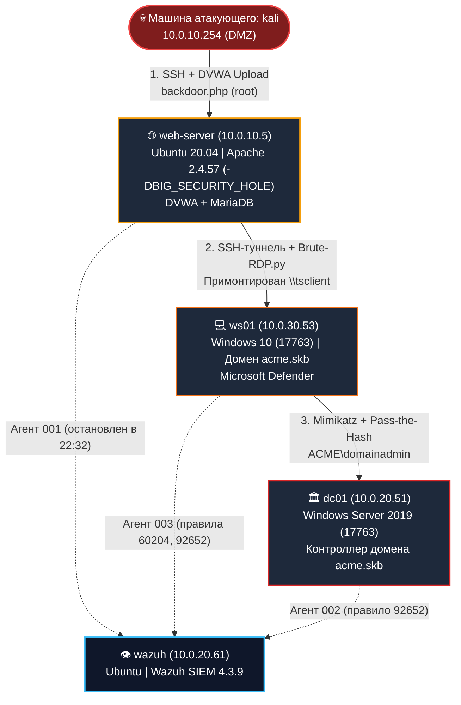
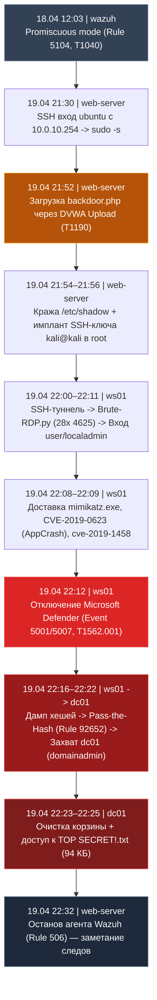

# 🛡️ Расследование инцидента ИБ (Blue Team / DFIR Case Study — `acme.skb`)

> 🌐 **Интерактивная веб-версия отчёта (Printable PDF):** [voobrazhenie21-lab.github.io/blue-team-incident-investigation](https://voobrazhenie21-lab.github.io/blue-team-incident-investigation/)
> 
> **О проекте:** Полный отчёт о форензик-расследовании многоэтапного вторжения в корпоративную доменную инфраструктуру `acme.skb` (облачный стенд VK Cloud). Расследование выполнено **Алексеем Жарковым** с применением **Wazuh SIEM (4.3.9)**, криминалистического анализа журналов Linux/Windows, артефактов файловой системы (`WER AppCrash`, `$Recycle.Bin`, `Recent LNK`, `RDP tsclient`) и маппинга на матрицу **MITRE ATT&CK**.

---

## 📋 Паспорт инцидента (Document Control)

| Параметр | Значение |
|:---|:---|
| **Идентификатор инцидента** | `INC-ACME-2023-0419` |
| **Исследуемый периметр** | Домен `acme.skb`, сегменты DMZ (`10.0.10.0/24`), Servers (`10.0.20.0/24`), Users (`10.0.30.0/24`) |
| **Ведущий специалист (DFIR)** | **Алексей Жарков** (Blue Team / SOC Analyst) |
| **Временное окно атаки** | `18.04.2023 12:03` — `19.04.2023 22:32` (МСК, UTC+3) |
| **Атакующий узел** | `kali` (`10.0.10.254`, сегмент DMZ) — деанонимизирован по артефактам `\\tsclient`, NTLM и SSH-ключу `kali@kali` |
| **Вердикт по компрометации** | 🔴 **ДОКАЗАНА ПОЛНАЯ КОМПРОМЕТАЦИЯ ДОМЕНА (`acme.skb`)** |
| **Вердикт по утечке данных** | 🔴 **УТЕЧКА ДОКАЗАНА** (`/etc/shadow` + `TOP SECRET!.txt` через RDP-туннель `\\tsclient`) |

---

## 📌 Шаг 1. Описание исследуемой инфраструктуры

| Хост (Hostname) | IP-адрес | Операционная система и стек | Роль в инфраструктуре |
|:---|:---|:---|:---|
| **`web-server`** | `10.0.10.5` | Ubuntu 20.04.1 LTS (ядро 5.4.0-42), Apache 2.4.57 (сборка из исходников с `-DBIG_SECURITY_HOLE`), DVWA, MariaDB | Веб-сервер сегмента DMZ. **Точка входа атакующего.** |
| **`ws01`** | `10.0.30.53` | Windows 10 (сборка 17763), в домене `acme.skb`, Microsoft Defender | Доменная рабочая станция пользователей. |
| **`dc01`** | `10.0.20.51` | Windows Server 2019 (сборка 17763) | Контроллер домена `acme.skb` (AD DS, DNS). |
| **`wazuh`** | `10.0.20.61` | Ubuntu, Wazuh 4.3.9 (менеджер + индексер + дашборд) | СЗИ: SIEM — централизованный сбор и корреляция событий с агентов. |
| **`wg`** | `10.0.10.250` | Linux | VPN-шлюз доступа в лабораторию (в атаке не участвовал). |
| **`kali`** | `10.0.30.12` | Kali Linux | Рабочая станция исследователя (форензика и сетевая разведка). |
| **`kali` (Attacker)** | `10.0.10.254` | Kali Linux (внешний узел в DMZ) | **Узел злоумышленника**, деанонимизированный по криминалистическим артефактам. |

---

## 🔍 Шаг 2. Сбор криминалистических данных по хостам

| Исследуемый хост | Собранные артефакты и источники данных |
|:---|:---|
| **`web-server` (`10.0.10.5`)** | 1. Журнал аутентификации `/var/log/auth.log.1` (SSH-входы 18–19.04.2023). 2. Журналы кастомной сборки Apache `/etc/apache2/logs/dummy-host-access_log` (полная запись веб-атаки). 3. История команд `/root/.bash_history`, `/home/ubuntu/.bash_history`. 4. Сеансы входа: `last -F` (`/var/log/wtmp`). 5. Журнал пакетов `/var/log/dpkg.log.1`, `/etc/passwd`, `cron`, `/tmp`. 6. Образец ВПО `/var/www/DVWA/hackable/uploads/backdoor.php` (сняты хеши MD5/SHA256). 7. СЗИ: события агента Wazuh (останов агента, правило `506`). |
| **`ws01` (`10.0.30.53`)** | 1. Журнал `Security.evtx` (`Get-WinEvent`: события `4624`, `4625`, `1102`). 2. Журнал `Microsoft-Windows-Windows Defender/Operational` (события `5001`, `5007`, `1116`, `1117`) и `Get-MpComputerStatus`. 3. СЗИ: алерты Wazuh (`60204` — брутфорс RDP, `92652` — Pass-the-Hash). 4. Файловые артефакты форензики: отчёт аварийного завершения **WER AppCrash (`CVE-2019-0623`)**, `User Account Pictures`, `C:\Users\Public\Documents`. 5. Локальные УЗ (`net user`), проверка истории PowerShell. |
| **`dc01` (`10.0.20.51`)** | 1. Журнал `Security.evtx` (`4624` — входы `domainadmin`/`domainuser` с `ws01`; `4662` — доступ к объектам AD DS). 2. Учётные записи домена `Get-ADUser` (сопоставление SID). 3. Криминалистика корзины `C:\$Recycle.Bin` (очистка `19.04.2023 19:23:28 UTC` пользователем с SID `*-1107`). 4. Конфиденциальный файл `C:\Users\domainadmin\Desktop\TOP SECRET!.txt` + LNK-артефакт открытия в `Recent`. 5. Проверка теневых копий (`vssadmin list shadows` — отсутствуют). 6. СЗИ: алерты Wazuh (вход на `dc01`, правило `92652`). |
| **`wazuh` (`10.0.20.61`)** | 1. Дашборд Security Events (DQL-запросы `rule.level >= 7`, `rule.mitre.id`). 2. Ключевые сработки правил: `5104` (promiscuous mode), `60204` (RDP brute force), `92652` (Pass-the-Hash), `506` (останов агента). 3. Телеметрия агентов `001–004`. |

---

## 🚨 Шаг 3. Обнаруженные вредоносные события (Хронологическая таблица)

*(Время приведено к часовому поясу МСК, UTC+3)*:

| Дата и время | Хост | Описание зафиксированного события | Комментарий и техника MITRE ATT&CK |
|:---:|:---:|:---|:---|
| `18.04.2023 12:03` | `wazuh` | Сетевой интерфейс переведён в неразборчивый режим (`promiscuous mode`), правило Wazuh `5104` | Сетевой сниффинг трафика (**T1040**) |
| `19.04.2023 21:30–21:47` | `web-server` | Успешные SSH-входы пользователя `ubuntu` с `10.0.10.254` (`auth.log.1`); далее выполнение `sudo -s` | Начальный доступ и повышение привилегий до `root` через беспарольный sudo (**T1078**) |
| `19.04.2023 21:49–21:52` | `web-server` | HTTP-обращения к DVWA: `GET /`, `/security.php`, `/vulnerabilities/upload/` | Разведка уязвимого веб-приложения |
| `19.04.2023 21:52:47` | `web-server` | `POST /vulnerabilities/upload/` — загрузка веб-шелла `backdoor.php` | Эксплуатация уязвимости File Upload (**T1190**). ВПО №1 |
| `19.04.2023 21:53–21:55` | `web-server` | Выполнение команд через веб-шелл (`?c=`): `whoami`, `id`, `hostname`, `cat /etc/passwd`, `cat /etc/shadow`, `cat /root/.bash_history` | Выполнение команд от имени `root` и кража хешей паролей `/etc/shadow` (**T1003**) |
| `19.04.2023 21:55:28` | `web-server` | Инъекция публичного SSH-ключа `kali@kali` в `/root/.ssh/authorized_keys` через веб-шелл | Закрепление доступа на сервере (**T1098.004**) |
| `19.04.2023 21:56–22:00` | `web-server` | Прямые SSH-входы `root` с узла атакующего `10.0.10.254` | Использование имплантированного SSH-ключа |
| `19.04.2023 22:00–22:20` | `ws01` | **28 неудачных попыток NTLM-входа** учётной записи `localadmin` (EventID `4625`) с `10.0.10.5`, правило Wazuh `60204` | Брутфорс RDP скриптом `Brute-RDP.py` (ВПО №5) через SSH-туннель (**T1110**) |
| `19.04.2023 22:02–22:07` | `ws01` | Входы УЗ `user` (сетевые + RDP) с `10.0.10.5`; в сеансе примонтирован RDP-диск `\\tsclient\_home_kali_Documents_Brute-RDP.py_rdpshare_` | Горизонтальное перемещение по SSH-туннелю и доставка арсенала ВПО с машины `kali` (**T1105**) |
| `19.04.2023 22:05:43` | `dc01` | Сетевой вход `domainadmin` с `10.0.30.53` (`ws01`); зафиксирован анонимный вход (null-сессия) | Первичное использование скомпрометированных доменных УЗ (**T1078**) |
| `19.04.2023 22:08:08` | `ws01` | Microsoft Defender заблокировал `HackTool:Win32/Mimikatz.D` (`\\tsclient\…\mimikatz.exe`), события `1116`/`1117` | Попытка дампа учётных данных из памяти LSASS (ВПО №2, **T1003**) |
| `19.04.2023 22:08:54` | `ws01` | Аварийное завершение процесса `CVE-2019-0623.exe`, зафиксирован криминалистический отчёт **WER AppCrash** | Неудачная попытка локального повышения привилегий LPE (ВПО №4, **T1068**) |
| `19.04.2023 22:09:15` | `ws01` | Defender заблокировал `Trojan:Win32/Sabsik.TE.A!ml` (`C:\Users\Public\Documents\CVEs\cve-2019-1458.exe`) | Попытка эксплуатации LPE Win32k `CVE-2019-1458` (ВПО №3, **T1068**) |
| `19.04.2023 22:12:12` | `ws01` | **Отключена защита в реальном времени Microsoft Defender** (событие `5001`); в `22:12:14` отключены `SpyNetReporting` и `SubmitSamplesConsent` (`5007`) | **Ослабление защиты (Defense Evasion, T1562.001)** — триггер инцидента из брифа |
| `19.04.2023 22:16–22:18` | `ws01` | Успешные входы `ACME\domainuser` (сетевые + RDP) с `10.0.10.5` | Компрометация доменной учётной записи |
| `19.04.2023 22:20:53` | `ws01` | Успешный сетевой вход `localadmin` с `10.0.10.5`, сработка правила Wazuh `92652` | Атака **Pass-the-Hash** / повторное использование NTLM-хеша (**T1550.002**) |
| `19.04.2023 22:22:58` | `dc01` | Успешный вход на контроллер домена `dc01` с `10.0.30.53` (правило `92652`); создан профиль `C:\Users\domainadmin` | **Полный захват контроллера домена `acme.skb`** |
| `19.04.2023 22:23:28` | `dc01` | Обращение к корзине `C:\$Recycle.Bin` и её очистка от имени SID `*-1107` (`domainadmin`) | Удаление артефактов и заметание следов (**T1070**) |
| `19.04.2023 22:24:40` | `dc01` | Доступ и модификация файла `C:\Users\domainadmin\Desktop\TOP SECRET!.txt` (94 048 байт); создан LNK-ярлык в `Recent` | **Компрометация и эксфильтрация секретных данных (T1005)** |
| `19.04.2023 22:32:56` | `web-server` | Принудительный останов службы агента Wazuh (`ossec`), правило Wazuh `506` | Попытка сокрытия следов на точке входа (**T1562.001**) |

---

## 🦠 Шаг 4. Детальный анализ обнаруженного вредоносного ПО (5 экземпляров)

### 1. `backdoor.php` — PHP Web Shell
- **Расположение:** `/var/www/DVWA/hackable/uploads/backdoor.php` (размер: `13 585` байт).
- **Хеш-суммы:**
  - `MD5`: `c97ba87745a4a9523e26c30a6529506a`
  - `SHA-256`: `eaa0a356da7712bf0f70f0f2a80f30447ca702ef721543f3ef75afd2fcc6e9d8`
- **Происхождение:** Публичный скрипт *«A robust backdoor script made by Daniel Berliner (qsdconsulting.com)»*.
- **Вектор доставки и роль:** Загружен `19.04.2023` в `21:52:47` через невалидируемую форму загрузки файлов в DVWA. Предоставляет веб-интерфейс файлового менеджера и выполнение произвольных команд ОС через GET-параметр `?c=`. Так как Apache был собран с флагом `-DBIG_SECURITY_HOLE` и запущен от `root`, веб-шелл сразу предоставил атакующему привилегии суперпользователя, позволив выгрузить `/etc/shadow` и прописать SSH-ключ в `/root/.ssh/authorized_keys`.

### 2. `mimikatz.exe` — Утилита дампа учётных данных (`HackTool:Win32/Mimikatz.D`)
- **Расположение:** Проброшенный сетевой диск RDP `\\tsclient\_home_kali_Documents_Brute-RDP.py_rdpshare_\mimikatz.exe`.
- **Назначение:** Извлечение открытых паролей, NTLM-хешей и Kerberos-билетов из памяти процесса `lsass.exe`.
- **Статус:** Зафиксирован антивирусом Microsoft Defender на `ws01` (`19.04.2023 22:08:08`, события `1116`/`1117`). После блокировки атакующий отключил защиту Defender в реальном времени и повторно сдампил учётные данные доменных пользователей.

### 3. `cve-2019-1458.exe` — Эксплойт локального повышения привилегий (`Trojan:Win32/Sabsik.TE.A!ml`)
- **Расположение:** `C:\Users\Public\Documents\CVEs\cve-2019-1458.exe` (запускался через `cmd.exe`).
- **Назначение:** Эксплуатация уязвимости ядра Windows (`Win32k` Elevation of Privilege, **CVE-2019-1458**) для получения прав `NT AUTHORITY\SYSTEM`.
- **Статус:** Обнаружен и помещён в карантин Microsoft Defender в `22:09:01–22:09:15`. Каталог `CVEs` впоследствии был удалён злоумышленником для сокрытия следов.

### 4. `CVE-2019-0623.exe` — Эксплойт повышения привилегий Win32k
- **Расположение:** Исполняемый файл был удалён атакующим, однако его запуск криминалистически доказан отчётом подсистемы **Windows Error Reporting (WER)**: `AppCrash_CVE-2019-0623.ex_…` от `19.04.2023 22:08:54`.
- **Назначение:** Альтернативная попытка повышения привилегий в ядре `Win32k`, завершившаяся аварийным сбоем процесса (Crash).

### 5. `Brute-RDP.py` — Скрипт словарного перебора RDP
- **Расположение:** `/root/1/Brute-RDP.py` на хосте `web-server` (в паре со словарём `/root/1/passwords.txt`); также засвечен в пути монтирования `\\tsclient\_home_kali_Documents_Brute-RDP.py_rdpshare_`.
- **Назначение:** Автоматизированный перебор паролей по протоколу RDP против хоста `ws01` (`10.0.30.53`). Сгенерировал 28 событий `4625` и успешно подобрал пароль к локальной учётной записи администратора `localadmin`. В конце атаки удалён злоумышленником командой `rm` (зафиксировано в `/root/.bash_history`).

---

## ⏱️ Шаг 5. Таймлайн развития атаки (Kill Chain)

---

## 🛠️ Шаг 6. Использованные инструменты форензики и СЗИ

| Собираемые и анализируемые данные | Инструмент / СЗИ |
|:---|:---|
| Централизованные события безопасности, корреляция и MITRE ATT&CK | **Wazuh SIEM 4.3.9** (дашборд `https://10.0.20.61`, язык запросов DQL) |
| Журналы аудита Windows (`Security.evtx`: 4624, 4625, 1102, 4662) | **Event Viewer** / **PowerShell (`Get-WinEvent`)** |
| Журналы и статус антивируса (детекты 1116/1117, отключение 5001/5007) | **Microsoft Defender** (`Operational`, `Get-MpComputerStatus`, `Get-MpThreatDetection`) |
| Журналы SSH-аутентификации и веб-сервера Apache | `/var/log/auth.log.1`, `/etc/apache2/logs/dummy-host-access_log`, `grep`/`zgrep` |
| История команд и сеансов пользователей Linux/Windows | `.bash_history`, `PSReadLine ConsoleHost_history.txt`, `last -F` (`/var/log/wtmp`) |
| Криминалистические артефакты ФС Windows (корзина, LNK, дампы сбоев) | `Get-ChildItem`, `C:\$Recycle.Bin`, `AppData\...\Recent`, **WER AppCrash** |
| Аудит доменных и локальных учётных записей, теневых копий | `Get-ADUser`, `net user`, `vssadmin list shadows` |
| Сетевая разведка и анализ сокетов | `nmap`, `ss -tlnp` |

---

## 🔍 Шаг 7. Причины возникновения инцидента (Root Cause Analysis)

### 7.1 Недостатки настройки средств защиты информации (СЗИ):
1. **Отсутствие политики блокировки УЗ (Account Lockout Policy):** В домене и на рабочих станциях не настроена блокировка после порогового числа неудачных входов, что позволило беспрепятственно провести словарный брутфорс RDP (`28` попыток подряд).
2. **Отключённая защита от подделки (Tamper Protection):** В Microsoft Defender отсутствовала защита от изменения настроек, что позволило атакующему с правами локального администратора выключить Real-Time Protection (событие `5001`) и отправку телеметрии SpyNet (`5007`).
3. **Отсутствие активного реагирования (Active Response) в SIEM:** Wazuh своевременно детектировал брутфорс (`60204`), Pass-the-Hash (`92652`) и остановку собственного агента (`506`), но правила автоматической блокировки и оповещения дежурной смены настроены не были.
4. **Отсутствие WAF и защиты службы агента:** Публичный веб-сервер не был прикрыт WAF, а служба `wazuh-agent` не имела защиты от остановки локальным процессом.

### 7.2 Архитектурные и конфигурационные недостатки инфраструктуры:
1. **Критическая уязвимость веб-сервера (`-DBIG_SECURITY_HOLE`):** На публичном сервере развёрнуто уязвимое приложение DVWA, а демон Apache собран из исходников с флагом `-DBIG_SECURITY_HOLE` и запущен **от имени `root`**. Любая загрузка веб-шелла мгновенно давала полный root-доступ к серверу.
2. **Слабая парольная политика и беспарольный `sudo`:** Пароль `localadmin` на `ws01` оказался словарным, а для пользователя `ubuntu` на `web-server` был разрешён `NOPASSWD: ALL` в `sudoers`.
3. **Нарушение модели Tiered Administration:** Доменный администратор (`domainadmin`) выполнял интерактивные входы на рядовую рабочую станцию `ws01`, оставив учётные данные в памяти LSASS без защиты `Credential Guard` и `LAPS`.
4. **Отсутствие межсетевого экранирования DMZ:** Из сегмента DMZ (`10.0.10.5`) были напрямую доступны порты RDP/SMB внутренней сети пользователей (`10.0.30.0/24`) и разрешён TCP-форвардинг в SSH (`AllowTcpForwarding yes`), что позволило пробросить RDP-туннель внутрь периметра.

---

## 🛡️ Шаг 8. Рекомендации по устранению и предотвращению (Hardening Roadmap)

1. **Ликвидация вектора начального проникновения:**
   - Вывести DVWA из продуктивного контура DMZ.
   - Переустановить Apache из официальных репозиториев с запуском от непривилегированной сервисной УЗ (`www-data`).
   - Запретить исполнение скриптов (`php_flag engine off`) в каталогах загрузки файлов и развернуть **WAF (ModSecurity + OWASP CRS)**.
2. **Управление учётными записями и паролями:**
   - Ввести политику блокировки УЗ (Account Lockout: 5 неудачных попыток на 30 минут).
   - Выполнить ротацию паролей всех УЗ (`ubuntu`, `root`, `user`, `localadmin`, `domainuser`, `domainadmin`, `alice`, `MSSQLSvc`) и **дважды сбросить пароль `krbtgt`** для аннулирования возможных Golden Ticket.
   - Удалить несанкционированный ключ `kali@kali` из `/root/.ssh/authorized_keys` и запретить беспарольный `sudo`.
3. **Укрепление СЗИ (Endpoint & SIEM):**
   - Принудительно включить **Tamper Protection** в Microsoft Defender через групповые политики (GPO).
   - Настроить в Wazuh модуль **Active Response** на критические правила: `60204` (брутфорс), `92652` (Pass-the-Hash), `506` (останов агента), `5001` (отключение AV).
4. **Сетевая сегментация:**
   - На межсетевом экране заблокировать любые входящие соединения из сегмента DMZ (`10.0.10.0/24`) в сегменты `10.0.20.0/24` (Servers) и `10.0.30.0/24` (Users) по портам `445/SMB` и `3389/RDP`.
   - В конфигурации `/etc/ssh/sshd_config` на `web-server` установить `AllowTcpForwarding no` и `PermitRootLogin no`.
5. **Защита Active Directory:**
   - Внедрить модель разделения привилегий (**Tier 0 / Tier 1 / Tier 2**): запретить вход учётной записи `domainadmin` на пользовательские рабочие станции через GPO (`Deny log on through Remote Desktop Services`).
   - Развернуть **Microsoft LAPS** и включить **Windows Defender Credential Guard** для защиты процесса `LSASS`.

---

## 🏁 Шаг 9. Итоговый вывод для руководства

В период с **18.04.2023 по 19.04.2023** инфраструктура компании подверглась целенаправленной многоэтапной кибератаке. 

- **Факт компрометации инфраструктуры:** **ДОКАЗАН В ПОЛНОМ ОБЪЁМЕ.** Злоумышленник (действовавший с хоста `10.0.10.254`) скомпрометировал веб-сервер DMZ, через SSH-туннель подобрал пароль к рабочей станции `ws01`, отключил антивирусную защиту Microsoft Defender, извлёк доменные учётные данные и методом Pass-the-Hash захватил контроллер домена `dc01` (`acme.skb`).
- **Факт утечки конфиденциальных данных:** **ДОКАЗАН.** Криминалистическая экспертиза подтвердила несанкционированный доступ атакующего к секретному документу `C:\Users\domainadmin\Desktop\TOP SECRET!.txt` (94 048 байт) на контроллере домена, очистку корзины для сокрытия следов и кражу теневого файла паролей `/etc/shadow` с веб-сервера. Эксфильтрация осуществлялась через проброшенный в RDP-сессии дисковый ресурс `\\tsclient` по SSH-туннелю.

Несмотря на попытку атакующего скрыть следы путём удаления эксплойтов и остановки агента Wazuh в `22:32:56`, сохранённые журналы виртуального хоста Apache, телеметрия Microsoft Defender, дампы аварийных сбоев `WER AppCrash` и база событий Wazuh SIEM позволили посекундно реконструировать всю цепочку атаки.

---

*Отчёт подготовил: **Алексей Жарков** &bull; Специалист по информационной безопасности (Blue Team / SOC / Pentest) &bull; [LinkedIn](https://www.linkedin.com/in/aleksei-zharkou/) &bull; [GitHub](https://github.com/Voobrazhenie21-lab)*
